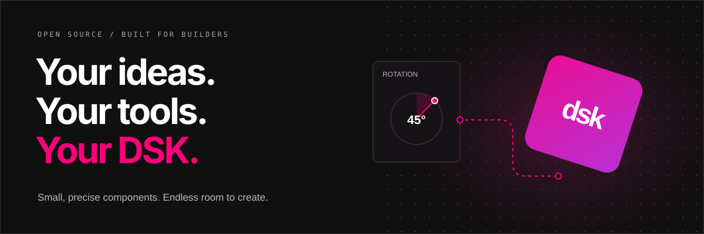
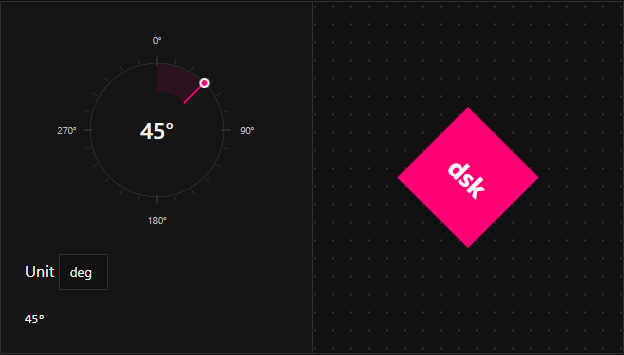

<p align="center">
  
</p>

<h1 align="center">Design System Kit</h1>

<p align="center">
  Precise controls for people building creative tools.<br />
  Built by <strong>Flowscape Team</strong> with TypeScript, HTML, and CSS.
</p>

<p align="center">
  <a href="LICENSE"></a>
  
  
  
  <a href="https://github.com/sponsors/Flowscape-UI"></a>
</p>

<p align="center">
  <a href="https://github.com/Flowscape-UI/dsk">GitHub</a> ·
  <a href="apps/docs/guide/introduction.md">Introduction</a> ·
  <a href="apps/docs/guide/installation.md">Quick start</a> ·
  <a href="packages/vanilla/README.md">API reference</a> ·
  <a href="apps/docs/ru/guide/introduction.md">Русская документация</a>
</p>



## Small components. Big possibilities.

Design tools need more than ordinary form fields. Numbers should be comfortable to drag. Colors should be visible while you edit them. Rulers should follow the same coordinates as your canvas.

**DSK brings those interactions to your application.** Start with a single input or compose an entire inspector for a design tool, whiteboard, diagram editor, or animation workspace. Keep your own renderer, application state, and visual identity.

- **Precision built in.** Numeric expressions, drag adjustment, keyboard controls, stepping, bounds, and linked fields.
- **Compose your interface.** Independent inputs, color controls, rotation, curves, layers, and canvas widgets.
- **Make it yours.** CSS custom properties, exposed shadow parts, and ordinary HTML for the surrounding layout.
- **Connect to your engine.** Read properties and listen to native `input` and `change` events.
- **Use your stack.** Browser-native custom elements with examples for Vanilla, React, Vue, Svelte, Angular, and SSR setups.

## See it move

<p align="center">
  
</p>

<p align="center"><sub>Captured from the real documentation demo. One control, connected to your object.</sub></p>

The [angles and curves guide](apps/docs/components/geometry.md) shows how to connect rotation and easing to your own interface. Prefer a still image? [View the preview](assets/readme/rotation-preview.png).

## Start building

Install DSK in your frontend project:

```sh
npm i @flowscape-ui/dsk
```

Import it once in your browser entry point:

```ts
import '@flowscape-ui/dsk';
import '@flowscape-ui/dsk/styles.css';
```

Then add a control to your HTML. It works without writing an event handler:

```html
<dsk-input aria-label="Width" value="160" min="0" step="1"></dsk-input>

<dsk-input-color aria-label="Fill" value="FF007A"></dsk-input-color>

<dsk-angle aria-label="Rotation" value="45" unit="deg"></dsk-angle>
```

Custom elements need explicit closing tags in HTML. Use `<dsk-input></dsk-input>`, not the self-closing form.

### Connect a value to your canvas

Add a field and an ordinary HTML object:

```html
<dsk-input
  id="width"
  aria-label="Width"
  value="160"
  min="24"
  max="400"
></dsk-input>
<div id="shape" style="width: 160px; height: 100px; background: #ff007a"></div>
```

Listen only when you need to update application state or rendering:

```ts
import type { DskInput } from '@flowscape-ui/dsk';

const width = document.querySelector<DskInput>('#width');
const shape = document.querySelector<HTMLElement>('#shape');

if (width && shape) {
  width.addEventListener('input', () => {
    shape.style.width = `${width.value}px`;
  });
}
```

Run this after the markup exists. `input` reports live edits; `change` reports a committed edit. For framework-specific setup and browser-only imports in SSR applications, see the [installation guide](apps/docs/guide/installation.md).

### Match your design

```css
dsk-input,
dsk-input-color {
  --dsk-input-background: #171717;
  --dsk-input-color: #ffffff;
  --dsk-input-border: 1px solid #363636;
  --dsk-input-border-radius: 4px;
  --dsk-input-focus-color: #ff007a;
}
```

Explore [styling and customization](apps/docs/guide/styling.md) for inherited tokens, slots, and CSS parts.

## Inside the kit

**19 custom elements**, organized around the work your users do.

| Family                                              | Components                                                                                  | What you can build                                                                      |
| --------------------------------------------------- | ------------------------------------------------------------------------------------------- | --------------------------------------------------------------------------------------- |
| [Inputs & groups](apps/docs/components/inputs.md)   | `dsk-input`, `dsk-input-hex`, `dsk-input-color`, `dsk-input-upload`, `dsk-input-group`      | Property inspectors, linked dimensions, color fields, and file selection with previews. |
| [Color & eyedropper](apps/docs/components/color.md) | `dsk-color-area`, `dsk-color-hue`, `dsk-color-alpha`, `dsk-color-eyedropper`                | Your own color picker with opacity and screen, page, or custom sampling modes.          |
| [Angles & curves](apps/docs/components/geometry.md) | `dsk-angle`, `dsk-curve`                                                                    | Rotation controls, editable easing, and motion previews.                                |
| [Layer tree](apps/docs/components/layers.md)        | `dsk-layer-tree`, `dsk-list-value`, `dsk-list-header`, `dsk-list-footer`, `dsk-tree-search` | Searchable hierarchies with selection, renaming, and reordering.                        |
| [Canvas widgets](apps/docs/components/canvas.md)    | `dsk-pan-zoom`, `dsk-ruler`, `dsk-canvas-marker`                                            | Navigable workspaces with rulers, guides, and coordinate-aware overlays.                |

## Your engine. DSK controls.

The documentation includes working examples with six different rendering and editing libraries. Each walkthrough includes the integration steps, a browsable project, and downloadable source files.

| Engine                                                                                             | Explore the example                                                                            |
| -------------------------------------------------------------------------------------------------- | ---------------------------------------------------------------------------------------------- |
|  **tldraw SDK**     | [Shape transforms, camera synchronization, rulers, and comments](apps/docs/examples/tldraw.md) |
|  **Excalidraw** | [Connect DSK controls to a whiteboard](apps/docs/examples/excalidraw.md)                       |
|  **React Flow**  | [Edit nodes and follow the viewport](apps/docs/examples/reactflow.md)                          |
|  **Three.js**        | [Control mesh transforms and a 3D scene](apps/docs/examples/three.md)                          |
|  **Konva.js**        | [Connect controls to an interactive canvas](apps/docs/examples/konva.md)                       |
|  **Fabric.js**      | [Edit canvas objects through a DSK inspector](apps/docs/examples/fabric.md)                    |

## Run the project locally

Use **Node.js 24.11+** and **pnpm 10.33.2**. Clone the [DSK repository](https://github.com/Flowscape-UI/dsk), then start development:

```sh
npm install --global pnpm@10.33.2
git clone https://github.com/Flowscape-UI/dsk.git
cd dsk
pnpm install
pnpm dev
```

Open the [playground](http://localhost:5173) or the [documentation](http://localhost:5174). Development uses package sources directly, so an initial build is unnecessary.

```text
apps/
  docs/                   English and Russian documentation
    tests/e2e/            Documentation browser tests
  playground/             Component playground
packages/
  vanilla/                @flowscape-ui/dsk
    src/                  Components and public exports
    tests/
      unit/               Component logic
      browser/            Browser interactions
      types/              Built public API declarations
```

| Command               | Purpose                                                                       |
| --------------------- | ----------------------------------------------------------------------------- |
| `pnpm dev:playground` | Run the component playground                                                  |
| `pnpm dev:docs`       | Run the documentation website                                                 |
| `pnpm build`          | Build the library and applications                                            |
| `pnpm test`           | Run unit tests                                                                |
| `pnpm test:browser`   | Run component browser tests                                                   |
| `pnpm test:docs`      | Run documentation browser tests after building                                |
| `pnpm test:package`   | Verify built ESM and IIFE bundles in a browser after building                 |
| `pnpm pages:build`    | Build documentation for GitHub Pages at `/dsk/`                               |
| `pnpm test:types`     | Validate public declarations after building                                   |
| `pnpm check`          | Run lint, formatting, type checks, unit tests, builds, and declaration checks |

Browser suites run separately from `pnpm check`. On Linux and macOS, install Chromium with `pnpm --filter @flowscape-ui/dsk exec playwright install chromium`. Windows uses installed Microsoft Edge. See [Contributing](CONTRIBUTING.md) for browser setup and development conventions.

## Built in the open

DSK is a project by **Flowscape Team**, released under the [MIT License](LICENSE). We are building reusable pieces for our own creative tools and for yours.

Read the [architecture](ARCHITECTURE.md), explore the [changelog](CHANGELOG.md), or follow the [contribution guide](CONTRIBUTING.md) to get involved.

**Help us keep building.** [Support Flowscape Team on GitHub Sponsors →](https://github.com/sponsors/Flowscape-UI)
